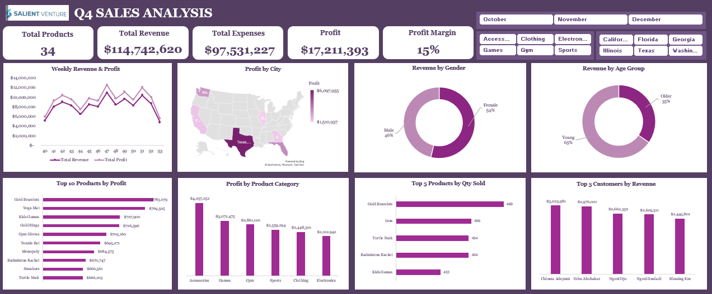

# 📊 Salient Venture Q4 2025 Sales Analysis

An interactive Excel dashboard analysing Q4 2025 transaction data for a US-based e-commerce retailer, to assess the effectiveness of the Q4 turnaround strategy, identify key revenue and profit drivers, and provide management with actionable insights to support data-driven decision-making.



---

## Business Problem

Salient Venture sells household and lifestyle products exclusively online, with its logistics hub in California and an ambition to expand into other US states.

Revenue fell by roughly **20% quarter over quarter** across Q1–Q3 2025, driven by poor inventory management and low customer retention. In response, the board introduced three changes:

1. **Performance-based incentives** for sales staff, replacing flat salaries
2. **Inventory diversification** into categories such as gym and clothing accessories
3. **Aggressive regional marketing** to enter new states

Q4 transaction volume surged. Management now needs to know whether that surge is **sustainable growth** or **short-term, low-value activity** before approving the 2026 budget.

## Business Questions

| Area | Question |
|---|---|
| **Sales performance** | What are total revenue, expenses, profit, profit margin and product count? |
| | What revenue and profit were generated in each week of Q4? |
| | Which cities generated the most profit? |
| **Product performance** | Which 10 products generated the most profit? |
| | Which product categories are the most profitable? |
| | What are the top 5 best-sellers by quantity? |
| **Customer insights** | Which 5 customers contribute the most revenue? |
| | How does purchasing behaviour differ by gender? |
| | Which age group generates the most revenue? |

## Dataset

Transaction-level sales records covering **1 October to 31 December 2025**.

| Field | Description |
|---|---|
| `Customer Name` | Buyer's full name |
| `City` | Customer location (values are US states, e.g. Texas, California) |
| `Gender` | Male / Female |
| `Customer Age` | Age of the customer |
| `Age Group` | Derived: Young (under 35) / Older (35 and above) |
| `Order Date` | Date of the transaction |
| `Quantity` | Units purchased in the order |
| `Selling Price` | Price per unit |
| `Cost Price` | Cost per unit |
| `Revenue` | Derived: Quantity × Selling Price |
| `Expenses` | Derived: Quantity × Cost Price |
| `Profit` | Derived: Revenue − Expenses |
| `Product Name` | Commercial name of the item |
| `Category` | Accessories, Clothing, Electronics, Games, Gym, Sports |

## Tools Used

**Microsoft Excel:**
  - PivotTables
  - Slicers
  - Charts
  - Map chart
  - Formulas

## Methodology

### 1. Data Cleaning
- Removed duplicate records
- Checked for and resolved missing values
- Standardised date formats
- Corrected inconsistent category names
- Created `Week` and `Month` fields from `Order Date`

### 2. Analysis with PivotTables
- Weekly revenue and profit trend
- Profit by city
- Revenue by gender and by age group
- Top 10 products by profit
- Profit by product category
- Top 5 products by quantity sold
- Top 5 customers by revenue

### 3. Visualisation and Dashboard
KPI cards, line chart, doughnut charts, bar charts and a filled map, all linked to slicers.

## Dashboard Features

- **5 KPI cards:** total products, revenue, expenses, profit and profit margin
- **9 visuals:** weekly trend, profit map, gender split, age-group split, top 10 products, category profit, top 5 by quantity, top 5 customers
- **3 sets of slicers:** month, city and product category, all of which update every chart and KPI at once

## Key Insights

| Metric | Result |
|---|---|
| Total revenue | **$114,742,620** (+31% vs Q3; above Q2's $107.5M) |
| Total expenses | $97,531,227 (≈85% of revenue) |
| Profit | **$17,211,393** |
| Profit margin | **≈15%** |
| Active products | 34 |

**Sales**
- Revenue and profit move together week to week, and both peaked in **Week 47**.
- Sales accelerated after Week 45, which is consistent with seasonal demand and promotional activity.
- Both measures fell sharply in the final week of December (see [Limitations](#limitations-and-next-steps)).

**Location**
- **Texas** is the strongest market at about **$6.10M profit (≈35% of total)**.
- Illinois and Georgia trail Texas and Florida.

**Products**
- **Accessories** is the most profitable category ($4.06M); **Electronics** is the least ($2.21M).
- **Gold Bracelets** rank #1 for both units sold (480) and profit ($783K).
- The top 10 products generated about **$7.10M, or 41% of total profit**.
- No single product dominates volume, which suggests a diversified portfolio.

**Customers**
- Female customers contributed **54%** of revenue.
- Younger customers contributed **65%** of revenue.
- The top 5 customers contributed about **12%** of revenue.

## Recommendations

1. **Protect margin.** With expenses at 85% of revenue, shift focus from revenue recovery to profitability through supplier negotiation, operational efficiency and pricing review.
2. **Back proven products.** Prioritise inventory and marketing for items that win on both volume and profit (Gold Bracelets, Kids Games, Badminton Rackets, Turtle Necks).
3. **Retain high-value customers.** Introduce loyalty rewards, personalised offers and dedicated account management for top spenders.
4. **Lift underperforming markets.** Build targeted strategies for Illinois and Georgia, and reduce reliance on Texas.
5. **Use segmentation.** Tailor promotions by gender and age group, and develop offers that broaden the older-customer base.

## Limitations and Next Steps

- **Partial weeks.** Using Excel's default `WEEKNUM`, Week 40 (1–4 Oct) and Week 53 (28–31 Dec) each contain only four days. The sharp drop in Week 53 may therefore be partly a partial-week effect rather than a true demand decline. Validating against daily data is a priority before drawing conclusions.
- **One quarter of evidence.** The Q4 surge is real, but it hasn't yet been shown to be durable.
- **No repeat-purchase data.** It's unclear whether the large young-customer segment is made up of one-time or returning buyers.
- **Concentration risk.** About 35% of profit comes from a single state.

**Suggested follow-up:** repeat-purchase and retention analysis, plus a comparison against Q1 2026 actuals, before the pivot is declared a success.

## Skills Demonstrated

- Retail and sales analytics
- PivotTables, XLOOKUP, Advanced Excel Formulas
- Dashboard design
- Business storytelling for executive decision-making

## Repository Structure

```
├── data/
│   └── Salient_Q4_2025_Sales.xlsx      # cleaned data
├── dashboard/
│   └── Salient_Q4_Dashboard.xlsx       # pivot tables + interactive dashboard
├── images/
│   └── dashboard.png                   # dashboard screenshot
└── README.md
```

## Author

**Oluwatosin Daodu**

🔗 [LinkedIn](https://www.linkedin.com/in/oluwatosin-daodu/)

---

⭐ If you found this useful, feel free to star the repo. Feedback and suggestions are welcome.
